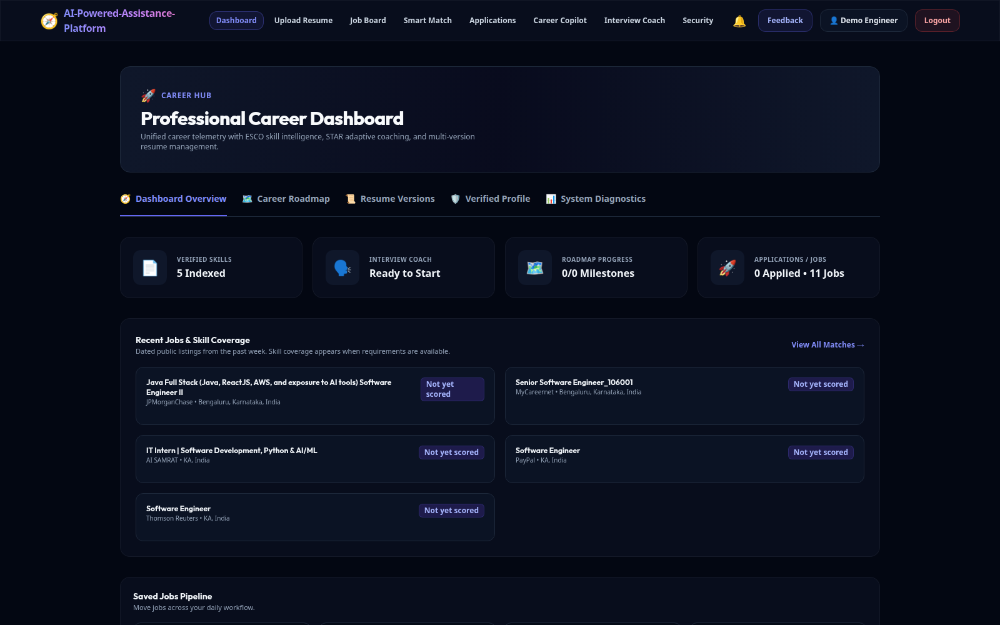
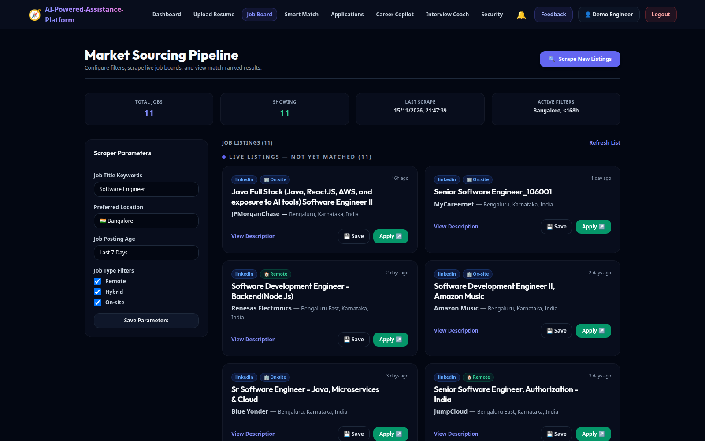
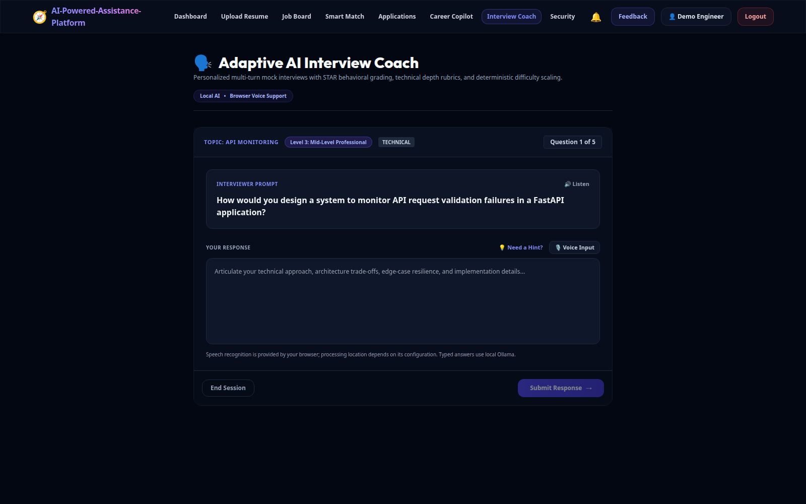
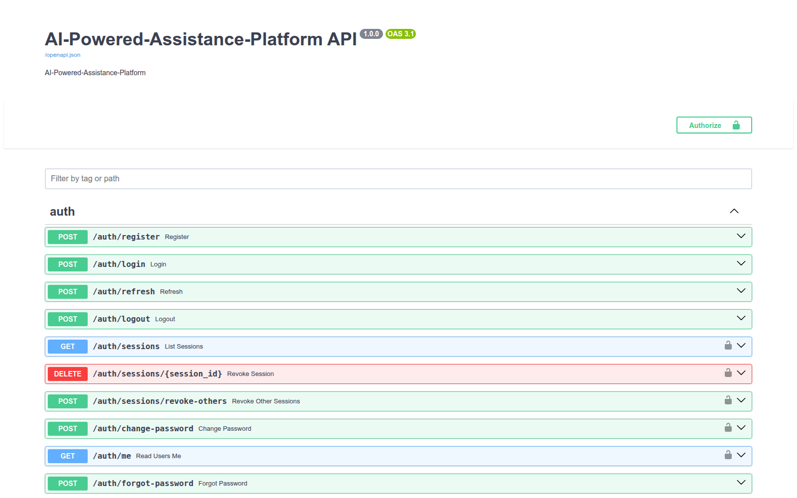
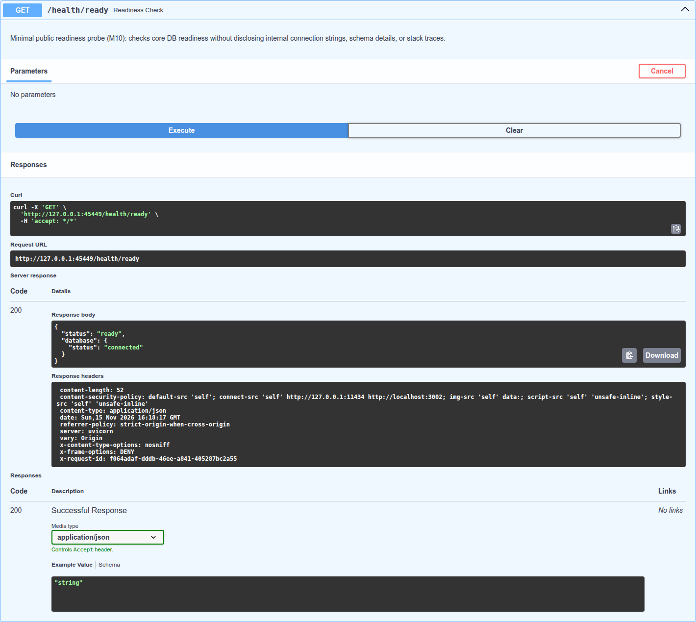
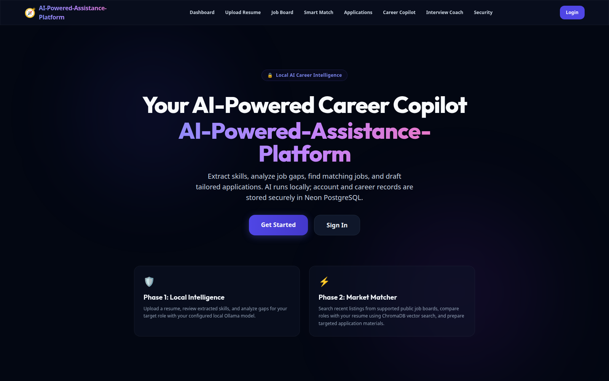
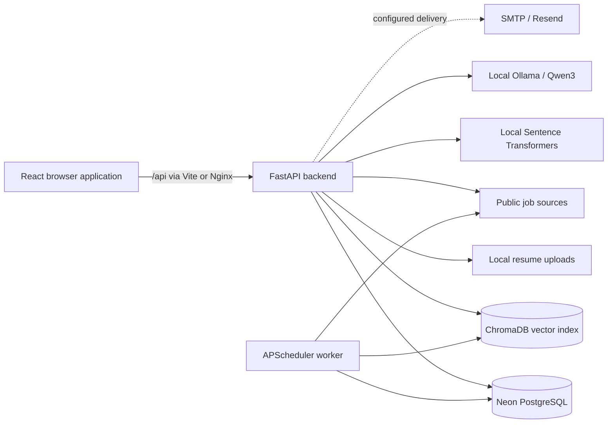

<div align="center">

# AI-Powered-Assistance-Platform

**A career workspace for resume intelligence, live job discovery, and AI interview practice.**

React · FastAPI · Neon PostgreSQL · ChromaDB · Ollama

[Screenshots](#screenshots) · [Run locally](#run-locally) · [Architecture](#architecture) · [Verification](#verification-and-remaining-work)

</div>

## About the project

AI-Powered-Assistance-Platform brings the job search journey into one application. Upload a resume, review extracted skills, search recent public job postings, compare your profile with a role, prepare application materials, and practice interviews with a local language model.

Ollama runs language models locally, while Sentence Transformers produces local embeddings for semantic search. **Neon PostgreSQL stores relational data**, and ChromaDB stores derived vectors. Neon, public job sources, initial model downloads, and configured email providers require internet access.

**Project status:** active development. The repair and verification loop is in progress; passing checks are recorded separately from untested features. Complete project acceptance remains open; interrupted workflow-step recovery and the full failure matrix still require work. See [current audit status](qa_tests/status.json) and `qa_tests/results/latest.json` after running checks.

## Screenshots

These are browser captures of the running application, taken on **November 15, 2026**. Account and resume data belong to a synthetic demonstration user in an isolated Neon test database. The job board shows actual public source listings; the interview question was generated by local Ollama. Listings and generated text will vary between runs.

### Career dashboard



### Live jobs and interview practice

| Recent job discovery | Adaptive interview coach |
| --- | --- |
|  |  |

### Running backend

| Interactive FastAPI documentation | Executed database readiness check |
| --- | --- |
|  |  |

<details>
<summary>View the public landing page</summary>



</details>

Screenshots use real services and a synthetic account; no personal resumes or credentials are included. Regenerate them with `.venv/bin/python qa_tests/tools/run_isolated_neon_checks.py --screenshots` (add `--resolve-dns` when the local resolver cannot reach Neon). This creates and retains a marked test database; it never writes to the application database.

## What you can do

| Area | Features |
| --- | --- |
| Resume workspace | Upload PDF/DOCX resumes, extract text and skills, review the profile, and manage resume versions. |
| Live job discovery | Search by your chosen title and location, filter by posting age, and retain source links and posting dates. Includes four-day and seven-day windows. |
| Semantic matching | Compare resume and job embeddings, rank matches, and request explanations. Unmatched listings remain visibly unscored. |
| Application preparation | Generate cover letters, tailor resume content, review ATS guidance, and track application history. |
| Career Copilot | Ask career questions through a streaming chat interface backed by local Ollama. |
| Interview practice | Configure profile-, role-, or job-based sessions; answer adaptive questions; request hints; and review rubric-based feedback. |
| Account and security | Registration, login, refresh sessions, email verification/reset flows, two-factor authentication, and audit records. Email delivery requires a configured provider. |
| Dashboard | Review profile information, application activity, saved jobs, and career planning tools. |

This is a feature overview, not a claim that every path has completed end-to-end acceptance. The [feature inventory](qa_tests/inventory.json) records remaining checks.

### How live job results work

**Scrape New Listings** requests current public listings through configured sources, including LinkedIn and Indeed via JobSpy. The application keeps verified, dated listings in Neon and indexes their descriptions in ChromaDB for matching. The board reads that real listing cache and applies your filters.

Template listings are excluded from live results. Unknown posting dates are not replaced with today's date. Provider failures, source restrictions, or narrow filters can produce an empty result; the application does not fabricate jobs to fill the screen. A newly opened board does not automatically imply a new provider search.

## Architecture



- **Neon PostgreSQL** is the only relational database: accounts, profiles, application records, interview sessions, and operational state live there.
- **ChromaDB** stores derived resume/job vectors for semantic retrieval. Its internal persistence is separate from relational application storage.
- **Ollama** performs local language-model inference. Interviews and role suggestions use a smaller dedicated model by default.
- **APScheduler** provides optional recurring work. Search/analysis/draft requests use a separate Neon-backed queue with bounded interruption recovery; workflow-step recovery remains under development.

## Technology stack

| Layer | Technologies | Purpose |
| --- | --- | --- |
| Frontend | React 18, Vite 7, React Router 7 | Browser interface, routing, and development server |
| UI and data | Tailwind CSS 3, Recharts 2, TanStack Query 5, Axios | Styling, charts, server state, and API requests |
| Backend | Python 3.12, FastAPI, Uvicorn, Pydantic | Typed HTTP APIs, validation, and service runtime |
| Relational storage | Neon PostgreSQL, SQLAlchemy 2, psycopg 3, Alembic | Persistent records, transactions, and migrations |
| Semantic search | ChromaDB 0.5, Sentence Transformers 3, `all-MiniLM-L6-v2` | Local embeddings and vector retrieval |
| Generative AI | Ollama, `qwen3:14b`, `qwen3:4b` | Career assistance, role suggestions, and interview generation/evaluation |
| Resume processing | PyMuPDF, python-docx, spaCy, Presidio | Document extraction, NLP, and sensitive-text processing utilities |
| Jobs and scheduling | python-jobspy 1.4.1, Beautiful Soup, APScheduler | Public listing ingestion and recurring tasks |
| Verification | pytest, Playwright, Vitest, ESLint | Python checks, browser journeys, frontend tests, and linting |
| Containers | Docker Compose, Nginx | API, worker, frontend, and Chroma services |

Exact dependency declarations live in [backend/requirements.txt](backend/requirements.txt) and [frontend/package.json](frontend/package.json).

## Run locally

Commands below are for Linux/macOS shells and start from the repository root. The tested workstation uses Python 3.12. Use **Node 20.19+ within v20, or Node 22.12+**, npm, a Neon development database, and a running local Ollama service. Leave enough disk space for dependencies, model weights, uploads, and vector indexes.

Once dependencies and configuration are ready, start the local workspace with one command:

```bash
python3 scripts/run_local.py
```

This starts the frontend on port 3002 and the API on port 8000, waits for database readiness, and runs the source-change/service watcher. It restarts its own exited processes with a bounded retry budget and keeps logs in `logs/local/`. Press Ctrl+C to stop its children. Existing listeners are preserved; stop manually started project servers before using it. `--api-port` and `--ui-port` select alternate local ports. It does not install packages, migrate the database, or start the email/retention scheduler.

### 1. Install dependencies

```bash
python3.12 -m venv .venv
.venv/bin/python -m pip install -r backend/requirements.txt
.venv/bin/python -m pip install https://github.com/explosion/spacy-models/releases/download/en_core_web_sm-3.7.1/en_core_web_sm-3.7.1-py3-none-any.whl

cd frontend
npm ci
cd ..
```

### 2. Configure the environment

Create environment files only when they do not already exist:

```bash
test -f .env || cp .env.example .env
test -f frontend/.env || cp frontend/.env.example frontend/.env
```

Edit `.env` with your own Neon connection and fresh authentication secrets. Set `FRONTEND_URL=http://localhost:3002` for the commands below. Keep `VITE_API_URL=/api` in `frontend/.env`. Configure optional email credentials only when you intend to send email; clear unused placeholder credentials.

The API loads process environment variables first, then root `.env`, then `backend/.env` without overwriting values already loaded. Alembic checks `backend/.env` before root `.env`; if both files exist, keep database settings consistent. Use process environment variables when you need one unambiguous configuration for API and migration commands.

### 3. Prepare local models

Ensure Ollama is running. If your installation already runs it as a service, use that instance. Otherwise run `ollama serve` in another terminal.

```bash
ollama pull qwen3:4b
ollama list

.venv/bin/python -c "from sentence_transformers import SentenceTransformer; SentenceTransformer('all-MiniLM-L6-v2', device='cpu')"
```

The first embedding initialization downloads model weights. `OLLAMA_MODEL`, `INTERVIEW_OLLAMA_MODEL`, and `ROLE_SUGGESTION_OLLAMA_MODEL` default to `qwen3:4b` to fit the tested workstation. For larger hardware, install `qwen3:14b` and choose it through configuration. Model loading and inference time depend on available RAM/VRAM and other applications using Ollama.

### 4. Apply migrations

Check that the configured URLs target your development database before applying schema changes:

```bash
.venv/bin/python -m alembic -c backend/alembic.ini current
.venv/bin/python -m alembic -c backend/alembic.ini upgrade head
```

### 5. Start the backend — terminal 1

```bash
RUN_SCHEDULER_IN_API=false python3 scripts/run_backend.py --host 127.0.0.1 --port 8000 --reload
```

The launcher selects the root `.venv` automatically. Check readiness before opening the frontend:

```bash
curl -fsS http://127.0.0.1:8000/health/ready
```

If your local DNS resolver cannot resolve Neon, set `NEON_DNS_FALLBACK=true` in your existing root `.env`, then restart the backend. This saved option also applies to workers and Alembic. It attempts system DNS first and uses public DNS only after a lookup error, while retaining the Neon hostname and TLS settings. Public answers expire with their DNS TTL (at most 60 seconds); it does not edit credentials or system DNS. The launcher flag `--resolve-neon-dns` enables the same behavior for a single launch.

Expected response: `{"status":"ready","database":{"status":"connected"}}`. This checks the database and required schema; it does not certify all AI services.

### 6. Start the frontend — terminal 2

```bash
cd frontend
npm run dev -- --port 3002 --strictPort --force
```

| Service | Address |
| --- | --- |
| Web application | <http://localhost:3002> |
| Backend Swagger UI | <http://127.0.0.1:8000/docs> |
| OpenAPI schema | <http://127.0.0.1:8000/openapi.json> |
| Database readiness | <http://127.0.0.1:8000/health/ready> |
| Ollama | <http://127.0.0.1:11434> |

Vite sends `/api` requests to `127.0.0.1:8000`. Keep both terminals running. The default Vite port without the explicit argument is 3000.

### 7. Optional scheduler — terminal 3

To enable recurring scraping and notification work, run one worker from the repository root:

```bash
PYTHONPATH=backend .venv/bin/python -m app.jobs.scheduler
```

Keep `RUN_SCHEDULER_IN_API=false` on the API when using this worker to avoid duplicate scheduling. Manual job searches work with the API running alone.

### Docker alternative

[docker-compose.yml](docker-compose.yml) defines the API, scheduler worker, Nginx frontend, and ChromaDB. It uses external Neon and host Ollama; it does not provision those services or download models.

```bash
docker compose config --quiet
docker compose up --build
```

The Compose frontend opens at <http://localhost:3000>. Set `FRONTEND_URL` accordingly. Ollama must accept connections from the Docker bridge through `host.docker.internal`. The Compose configuration was checked; a complete container deployment has not been verified in this audit.

## First-use walkthrough

1. Create an account and sign in. Configure email delivery to use verification and password-reset emails.
2. Upload a PDF or DOCX resume and review the extracted profile and skills.
3. Open **Job Board**, enter your title and location, select **Last 4 Days** or **Last 7 Days**, then click **Scrape New Listings**.
4. Open **Smart Match** to compare listings with your resume; review the source posting before applying.
5. Use the application preparation tools to draft materials and record your application activity.
6. Open **Interview Coach**, choose a target, begin a session, and answer questions to receive local AI feedback. Browser speech recognition depends on your browser/provider configuration; typed answers use local Ollama.

## Repository layout

```text
AI-Powered-Assistance-Platform/
├── backend/
│   ├── app/                 # FastAPI services, data access, local AI
│   ├── alembic/             # PostgreSQL schema migrations
│   └── requirements.txt
├── frontend/
│   ├── src/                 # React pages, hooks, components, API client
│   └── package.json
├── qa_tests/                # All automated tests and verification tools
│   ├── unit/                # Fast checks without a live database
│   ├── backend/             # Disposable database suite; AI is mocked
│   ├── integration/         # Real Neon, Chroma, job sources and Ollama
│   ├── browser/             # Browser rendering checks
│   ├── frontend/            # Vitest tests
│   ├── tools/               # Isolated Neon runner and inventory generator
│   └── run_checks.py        # Run once, repeat, or watch for changes
├── docs/screenshots/        # Actual browser captures
├── scripts/                 # Backend launcher and source-release utilities
├── .env.example
└── docker-compose.yml
```

## Verification and remaining work

Run focused checks from the repository root:

```bash
.venv/bin/python -m pip install -r qa_tests/requirements.txt
.venv/bin/python -m pytest -c qa_tests/pytest.ini qa_tests/unit -q
cd frontend
npm run lint
npm test
npm run build
```

Database integration checks require an **isolated disposable Neon database**. The normal backend suite can truncate test tables, so never target the application database. The guarded runner creates a marked disposable database when your Neon role permits database creation:

```bash
.venv/bin/python qa_tests/tools/run_isolated_neon_checks.py
.venv/bin/python qa_tests/tools/run_isolated_neon_checks.py --reuse NAME qa_tests/backend
.venv/bin/python qa_tests/tools/run_isolated_neon_checks.py --reuse NAME qa_tests/integration/test_live_browser.py
```

Use `--resolve-dns` if the local resolver fails for the configured Neon hostname. This opt-in flag uses public DNS for that process, retains the original hostname/TLS settings, and changes no system configuration. The runner isolates uploads/vectors, disables email delivery and scheduling, uses synthetic accounts, and retains the test database for inspection. The backend suite mocks AI; the real integration suite does not. Run these separately so mock fixtures cannot contaminate real-service checks.

Run the regression loop locally:

```bash
.venv/bin/python qa_tests/run_checks.py
.venv/bin/python qa_tests/run_checks.py --repeat 2
.venv/bin/python qa_tests/run_checks.py --watch
.venv/bin/python qa_tests/run_checks.py --watch --services
.venv/bin/python qa_tests/run_checks.py --integration --backend-suite --resolve-dns
```

Watch mode reruns checks after maintained source changes. It reports failures for repair; it does not rewrite code automatically. Logs and exact exit codes are saved in `qa_tests/results/`. Add `--integration` to a single run for isolated real-service checks; database integration is intentionally excluded from watch mode.
With `--services`, watch mode also probes the running frontend, backend, database readiness and configured local models every 30 seconds. These probes are read-only.
`--integration` runs real local-vector, AI/API and two-user browser checks in separate processes. `--backend-suite` adds the broader isolated Neon suite with mocked AI. Both modes create marked disposable databases and retain them; neither runs continuously in watch mode. Browser checks use Chrome; set `CHROME_EXECUTABLE` if it is installed somewhere other than `/usr/bin/google-chrome`.

Searches, resume analysis and application drafts now save a versioned request in Neon before returning a task ID. A queue consumer runs independently of the optional email scheduler, claims work with row locks, renews its lease, and reclaims expired leases after process loss. Results from stale workers are rejected. Interrupted work has at most three attempts; regular execution failures remain visible as failures. Internal request payloads are hidden from public status responses. Child searches use deterministic IDs to avoid duplicates after a parent retry. This provides at-least-once execution for these searches/drafts, not employer submission or exactly-once side effects.

Structured workflows support profile summaries, live searches, AI application drafts, and explicitly approved application tracking records. Recovery for interrupted workflow steps, and the broader failure/concurrency/voice verification matrix, still need acceptance work. Passing selected journeys or capturing these screens does not establish production readiness.

## Troubleshooting

| Symptom | What to check |
| --- | --- |
| Vite reports `ECONNREFUSED 127.0.0.1:8000` | Start the backend and check `/health/ready`. The frontend cannot connect while the API is stopped or restarting. |
| Blank development page | Run `npm ci` in `frontend/`, restart Vite with `--force`, and check the browser console. The dependency preflight detects known broken React installs. |
| Missing Python modules | Install requirements into root `.venv` and start with `scripts/run_backend.py`. |
| Empty job results | Run a fresh scrape, widen the posting window/location, and check source availability. Empty results are not filled with templates. |
| Interview AI unavailable | Check `ollama list`, the configured interview model, free RAM/VRAM, and backend logs. |
| Readiness returns HTTP 503 | Check Neon connectivity, TLS settings, and migrations for the configured development database. |
| Model installation or uploads fail | Check available disk space. The launcher requires at least 128 MB free; model downloads need substantially more. |

## Configuration reference

| Variable | Purpose |
| --- | --- |
| `DATABASE_URL` | Neon PostgreSQL application URL, with TLS enabled |
| `DIRECT_URL` | Direct Neon URL for migrations; keep it consistent with the application target |
| `NEON_DNS_FALLBACK` | Optional public DNS fallback after system lookup failure; default `false` |
| `DATABASE_STATEMENT_TIMEOUT_MS` | Runtime transaction-local query deadline; default 30000 ms, valid range 1000–600000. Migrations retain their normal DDL timing. |
| `SECRET_KEY` | Strong random token-signing secret |
| `TWO_FACTOR_ENCRYPTION_KEY` / `TWO_FACTOR_BACKUP_CODE_PEPPER` | Stable encryption key and secret pepper for two-factor credentials |
| `OLLAMA_BASE_URL` | Local Ollama endpoint; default `http://127.0.0.1:11434` |
| `OLLAMA_MODEL` | Default model for general AI operations |
| `INTERVIEW_OLLAMA_MODEL` | Dedicated interview model; default `qwen3:4b` |
| `ROLE_SUGGESTION_OLLAMA_MODEL` | Dedicated role-suggestion model; default `qwen3:4b` |
| `CHROMA_PATH` | Local vector index directory |
| `CHROMA_HOST` / `CHROMA_PORT` | Optional remote Chroma service |
| `UPLOAD_DIR` | Resume upload directory shared with workers |
| `FRONTEND_URL` | Browser origin used for links and CORS |
| `RUN_SCHEDULER_IN_API` | Disable when using a separate scheduler worker |
| `SMTP_*` / `RESEND_API_KEY` | Optional outbound email configuration |
| `VITE_API_URL` | Browser API base; use `/api` with the supplied proxy |
| `BACKEND_PROXY_TARGET` | Optional Vite proxy target; default `http://127.0.0.1:8000` |

Generate your own secrets and keep them in ignored environment files. Never put database credentials in `VITE_*` variables: Vite embeds those values in browser assets. Resume text, profiles, application records, and interview state are stored in Neon; local model inference does not make the whole application offline.

## Useful project references

- [Frontend dependencies and commands](frontend/package.json)
- [Backend dependencies](backend/requirements.txt)
- [Container configuration](docker-compose.yml)
- [Source-derived feature inventory](qa_tests/inventory.json)
- [Repair and verification status](qa_tests/status.json)
- `qa_tests/results/latest.json`, generated when you run the checks
- [Release builder](scripts/build_release.py), which excludes credentials and runtime stores

Dependency licenses remain with their respective projects. This repository currently has no project-level `LICENSE` file.
