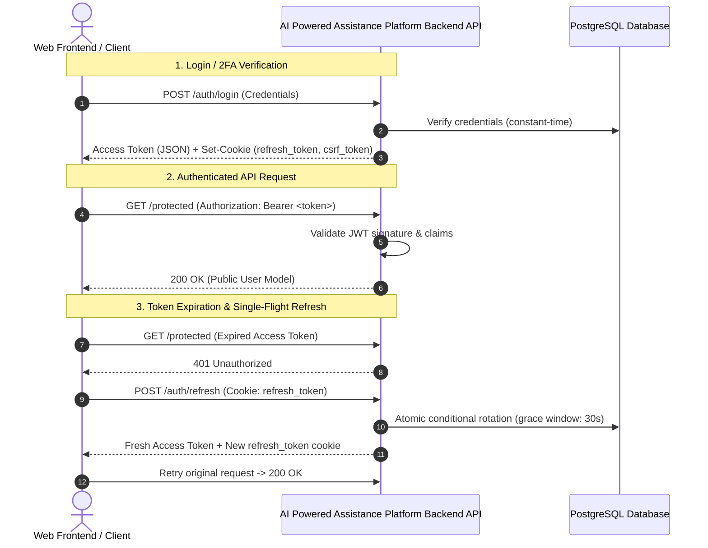

# AI Powered Assistance Platform Authentication & Security Deployment Model (M5)

## 1. Architecture Overview

AI Powered Assistance Platform enforces a unified, defense-in-depth authentication model combining short-lived Bearer tokens for API authorization with secure, atomic HTTP cookies for session persistence and refresh.



---

## 2. Authentication Components

### A. Access Tokens (Bearer)
- **Format**: JSON Web Token (JWT) signed with HMAC-SHA256 (`HS256`).
- **Lifespan**: 15 minutes (`ACCESS_TOKEN_EXPIRE_MINUTES = 15`).
- **Transport**: `Authorization: Bearer <access_token>` request header.
- **Claims**:
  - `sub`: User ID
  - `email`: User email address
  - `token_type`: `"access"`
  - `iat`: Issuance timestamp (used for recent-auth checks)
  - `exp`: Expiration timestamp

### B. Refresh Tokens (Session Persistence)
- **Entropy**: Cryptographically secure 256-bit random tokens (`secrets.token_urlsafe(32)`).
- **Storage at Rest**: Only the SHA-256 hash (`hashlib.sha256(token.encode()).hexdigest()`) is stored in the database. Raw refresh tokens are never persisted in plaintext.
- **Transport**: Stored in an `HttpOnly`, `SameSite=Lax` (or `Strict`), `Secure` (when `is_production` is true) cookie.
- **Atomic Rotation**: When `/auth/refresh` is called, the database unconditionally performs an atomic conditional update:
  ```sql
  UPDATE refresh_tokens
  SET revoked_at = :now, replaced_by = :new_token_hash
  WHERE token_hash = :current_token_hash
    AND revoked_at IS NULL
    AND expires_at > :now
  RETURNING user_id;
  ```
- **Duplicate-Refresh Grace Period (30 Seconds)**:
  - Concurrent network requests hitting `/auth/refresh` within 30 seconds of a rotation return HTTP 200 with the active successor token rather than abruptly terminating the session.
  - Replays outside the 30-second grace window trigger automatic revocation of **all** sessions for the affected user.

### C. Double-Submit CSRF Protection
- **Target**: State-changing methods (`POST`, `PUT`, `PATCH`, `DELETE`).
- **Mechanism**: The backend issues a `csrf_token` cookie. The client echoes this value in the `X-CSRF-Token` header.
- **Verification**: Verified using constant-time comparison (`hmac.compare_digest`).
- **Bearer Token Exception**: When a valid cryptographically authenticated Bearer token is provided **and** no ambient `csrf_token` cookie is present (indicating a purely programmatic / API client), CSRF validation is bypassed. If a cookie is present, CSRF validation is strictly enforced.

---

## 3. Two-Factor Authentication (TOTP Hardening - M1)

- **Secrets at Rest**: TOTP secrets are encrypted using authenticated encryption (`Fernet` / AES-128-CBC + HMAC-SHA256) using a 256-bit encryption key (`TWO_FACTOR_ENCRYPTION_KEY`).
- **Replay Protection**: The last validated TOTP time step is recorded in `last_totp_step`. A token for the same or previous time step is immediately rejected to prevent time-window replay attacks.
- **Clock Drift**: A tolerance window of `valid_window=1` (±30 seconds) accommodates standard clock skew while rejecting stale codes.
- **Backup Codes**:
  - 10 codes generated with 64 bits of entropy (`secrets.token_hex(8)`).
  - Stored at rest as keyed HMAC-SHA256 hashes (`hmac.new(SECRET_KEY, code, sha256)`).
  - Atomically consumed in a single atomic SQL statement (`UPDATE ... SET used_at = now WHERE ... AND used_at IS NULL`).
- **Rate Limiting & Lockout**: Maximum 5 failed 2FA verification attempts within a 15-minute sliding window before throttling kicks in.

---

## 4. CORS, CSP, and HSTS Policy (M5)

- **CORS**: Configured strictly against whitelist origins specified in `CORS_ORIGINS`.
- **CORS on Errors**: Custom exception handlers and middleware guarantee that 401, 403, and 500 responses retain `Access-Control-Allow-Origin` and `Access-Control-Allow-Credentials` headers so client error handlers receive actionable responses.
- **Content Security Policy (CSP)**:
  - Standard routes: Strict origin isolation (`default-src 'self'`).
  - Documentation routes (`/docs`, `/redoc`, `/openapi.json`): Permitted CDNs for Swagger/Redoc UI (`cdn.jsdelivr.net`, `fastapi.tiangolo.com`).
- **HSTS**: `Strict-Transport-Security: max-age=31536000; includeSubDomains` enforced when `is_production` is true.

---

## 5. Rate Limiting Model (M6)

- **Storage**: Keyed storage using Redis (`RATE_LIMIT_STORAGE_URL`) in multi-worker production environments, falling back to local memory for single-instance development.
- **Key Generation Strategy**:
  - Authenticated requests: Bound strictly to the authenticated `user:{user_id}` bucket.
  - Unauthenticated requests: Bound to `ip:{client_ip}`. `X-Forwarded-For` is trusted only when `TRUST_PROXY_HEADERS` is explicitly true or `is_production` is active.
- **Sensitive Limits**:
  - `/auth/login`: 8 attempts / minute (plus IP throttle).
  - `/auth/2fa/verify`: 5 attempts / 15 minutes.
  - `/jobs/fetch`: 15 requests / minute.
  - `/apply/generate/{job_id}`: 10 requests / minute.
  - `/orchestrator/workflows`: 10 requests / minute.
  - `/orchestrator/tools/execute`: 20 requests / minute.
  - `/copilot/chat`: 10 requests / minute.
  - `/interview/start`: 5 requests / minute.
